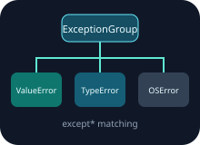

## 🧭 Overview

A dependency-free Python 3.11+ CLI demonstrating ExceptionGroup splitting and except* handling for independent failure types.

## ✨ Features

- 🧩 Raise one group containing several exception types.
- 🎯 Handle ValueError, TypeError, and OSError with separate except* clauses.
- 📦 Inspect the subgroup handled by each clause.
- 🧪 Run deterministic standard-library tests.

## 🎬 Demo

No hosted demo is provided. Run the local examples with the command below.

## ⚡ Quick Start

~~~bash
python exception_group_lab.py
~~~

## 🧰 Tech Stack

- Python 3.11+
- Standard library; no runtime service or external API is required

## 🗂️ Folder Structure

~~~text
python-exception-group-lab/
├── exception_group_lab.py
├── test_exception_group_lab.py
├── assets/mark.svg
├── .gitignore
├── LICENSE
└── README.md
~~~

## 🗺️ Roadmap

- [x] Core behavior and local examples
- [x] Custom SVG and setup documentation
- [ ] Add more guided exercises from community feedback

## 🤝 Contributing

Issues and focused pull requests are welcome. Keep examples deterministic and within the documented scope.

## 📄 License

MIT License. See [LICENSE](LICENSE).

